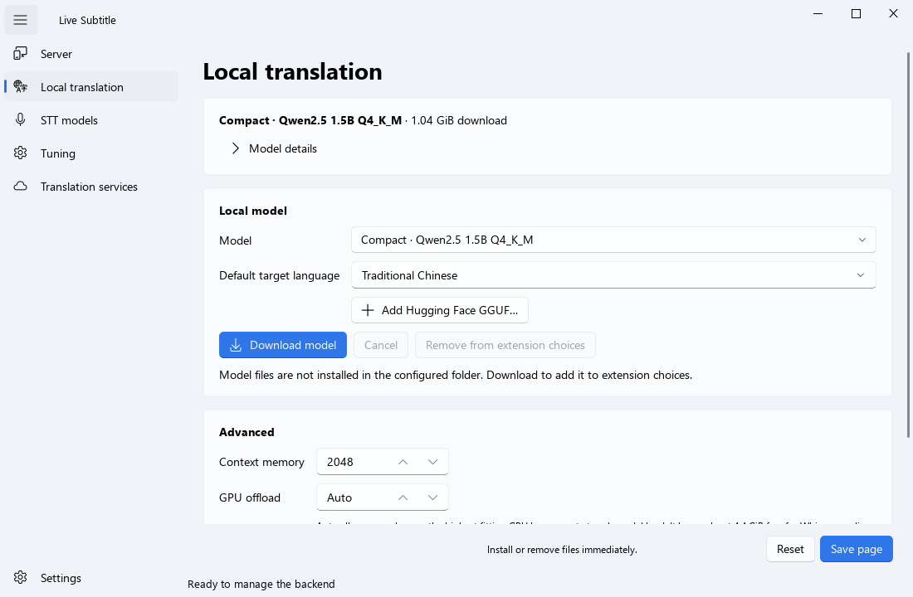
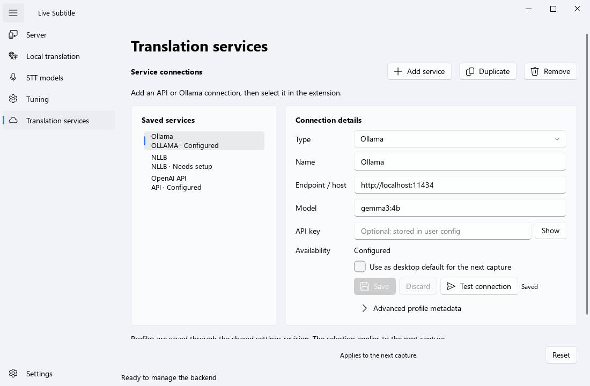
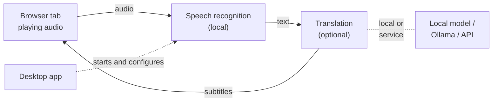

<div align="center">

<h1>Live Subtitle</h1>

<p><strong>Real-time subtitles and translation for audio playing in a browser tab. Speech recognition runs locally.</strong></p>

<p>
  <a href="LICENSE"></a>
  <a href="https://github.com/xu-0306/live-subtitle/releases/latest"></a>
  
  
</p>

<p>
  <a href="#quick-start">Quick start</a> ·
  <a href="#features">Features</a> ·
  <a href="#how-it-works">How it works</a> ·
  <a href="https://github.com/xu-0306/live-subtitle/releases">Download</a> ·
  <a href="README.zh-TW.md">繁體中文</a>
</p>

</div>

<p align="center">
  <picture>
    <source media="(prefers-reduced-motion: reduce)" srcset="docs/media/demo.png">
    
  </picture>
  <br>
  <sub>Video: <a href="https://www.youtube.com/watch?v=c8_BIamLESg">“Improve Your Speaking”</a> by Conor Neill, CC BY.</sub>
</p>

Live Subtitle captures the audio of a Chrome or Edge tab, turns the speech into subtitles with Whisper on the local machine, and shows them over the page. Translation is optional and can run on the same machine or through a translation service you configure.

> [!NOTE]
> Public preview, Windows only. The extension is loaded through Developer mode, and the Windows app is not code-signed, so SmartScreen may warn on first launch.

## Quick start

Requirements: 64-bit Windows and a Chromium-based browser (Chrome, Edge). An NVIDIA GPU is recommended but not required.

1. **Download** both files from the [latest release](https://github.com/xu-0306/live-subtitle/releases/latest): `Live-Subtitle-windows-x64.zip` and `Live-Subtitle-chrome-extension-v<version>.zip`.
2. **Start the desktop app.** Unzip the Windows package and run `live-subtitle.exe`. On first launch it reads the GPU's memory and recommends a speech recognition model and translation setup.
3. **Start the server.** On the **Server** page, click **Start backend** and wait until it reports that it is running.
4. **Add the extension.** Unzip the extension package, open `chrome://extensions`, turn on **Developer mode**, click **Load unpacked** and choose the unzipped folder.
5. **Start capturing.** In a tab that is playing speech, click the Live Subtitle icon in the toolbar, choose a translation option and target language, and click **Start capture**. The subtitle box can be dragged and resized.

Each speech recognition model is downloaded the first time it is used, so the first capture takes longer to start.

<details>
<summary>Run from source instead</summary>

Requirements: Windows, Python 3.10 or newer, a PyTorch build for your CUDA or CPU setup (installed separately), and a Chromium browser.

```powershell
git clone https://github.com/xu-0306/live-subtitle.git
Set-Location live-subtitle
py -3 -m venv .venv
.\.venv\Scripts\Activate.ps1
python -m pip install --upgrade pip
python -m pip install -r backend\requirements.txt
python -m pip install -r gui\requirements.txt
```

Install PyTorch for your environment, then start the desktop app:

```powershell
.\Start-GUI.bat
```

`.\Start-GUI.bat --check` runs only the environment check. Load the `chrome-extension` folder as an unpacked extension from `chrome://extensions`.

</details>

## Features

- **Works on any tab:** video sites, livestreams and web meetings. Several tabs can be captured at the same time.
- **Optional translation:** original text only, a local GGUF model, or a configured service such as Ollama or an OpenAI-compatible API.
- **Model recommendation:** on first launch the app reads GPU memory and suggests a low-latency, everyday or quality combination; without a supported GPU it suggests a smaller model.
- **Adjustable subtitles:** position, size, text size, opacity, number of history lines, and whether partial results are shown.
- **Models load on demand:** nothing is loaded until a tab starts capturing, and the local translation model is released when the last tab stops.

### Desktop app

<table>
  <tr>
    <td width="50%">
      <picture>
        <source media="(prefers-color-scheme: dark)" srcset="docs/media/gui-local-dark.png">
        
      </picture>
      <p align="center"><em>Local translation models</em></p>
    </td>
    <td width="50%">
      <picture>
        <source media="(prefers-color-scheme: dark)" srcset="docs/media/gui-services-dark.png">
        
      </picture>
      <p align="center"><em>Translation service connections</em></p>
    </td>
  </tr>
</table>

| Page | Purpose |
| --- | --- |
| **Server** | Start, stop and restart the local server, and read its logs. |
| **Local translation** | Download and manage translation models that run on this computer. |
| **Speech recognition** | Choose the Whisper speech-recognition model. |
| **Tuning** | Adjust subtitle and streaming behaviour. |
| **Translation services** | Save and test connections to Ollama, OpenAI-compatible APIs, vLLM and similar services. |
| **Settings** | Theme, where settings and models are stored, the model recommendation, and the app version with its update check. |

## How it works



The extension captures the tab's audio and sends it to the local server at `ws://127.0.0.1:8765/asr`. The server turns speech into text with [WhisperLiveKit](https://github.com/QuentinFuxa/WhisperLiveKit), optionally translates it, and sends the subtitles back to the page. The desktop app stores the settings, model files and translation-service connections, and starts and stops the server.

### Translation choices

| Choice | What happens |
| --- | --- |
| **None** | Show the recognized speech without translation. |
| **Local translation** | The app downloads a llama.cpp runtime and GGUF translation models. Translation runs on this computer. |
| **Translation services** | Use a saved service connection (local, network, self-hosted or cloud: Ollama, OpenAI-compatible APIs, vLLM and compatible adapters). The service does the translation. |

### Privacy

Tab audio is sent only to the local server. If a translation service is selected, the recognized text (not the audio) is sent to that service, which may run locally, on the network or in the cloud. With local translation, recognition and translation both stay on the same machine. API keys, credentials and local model paths are never passed to web pages.

**Update check.** The desktop app and the extension each ask GitHub's public API for the latest release (`GET https://api.github.com/repos/xu-0306/live-subtitle/releases/latest`) so they can tell you when a new version exists. Only that version query is sent: no audio, text, settings, keys or account, and no cookies or referrer. As with any web request, GitHub sees your IP address. Nothing is downloaded or installed automatically. The app checks at most once a day at start-up and the extension about once a day in the background; a failed check, such as being offline, is silent. Turn it off under **Settings → About** in the app and **Options → About & updates** in the extension.

## Status and limits

- In active development. Recognition and translation quality depend on the model, language, audio and hardware.
- Without a GPU, local recognition and translation are noticeably slower.
- Windows x64 only for the desktop app.
- The extension is loaded manually through Developer mode; it is not in the Chrome Web Store.
- The Windows executable is not code-signed.

<details>
<summary>Models, data folders and configuration</summary>

### Models and application data

Models are not included in the release packages. Speech recognition models download the first time they are needed; local translation models are downloaded from the **Local translation** page.

On first launch, a setup assistant reads total and free NVIDIA video memory through `nvidia-smi`, budgets Whisper and local translation together, and recommends a low-latency, everyday or quality pair. Below 8 GiB, or without a supported NVIDIA GPU, it recommends a smaller Whisper model with CPU translation and explains the external-service option. Run it again under **Settings → Recommend model setup**.

Applying a recommendation saves the choices but does not start large downloads. Start them from **Speech recognition** and **Local translation**. A recommended local translation model becomes the default only after its download and hash check finish.

Default data layout on Windows:

```text
%APPDATA%\Live Subtitle
├─ config.yaml
├─ Speech models\
└─ Local Translation Models\
```

Set the shared model folder once under **Settings → Model storage**. Whisper weights and local translation files stay in separate folders beneath it.

Settings from the older `%APPDATA%\STT-TTS\config.yaml` can be copied to the new folder. The old folder is not deleted, and model paths you set explicitly keep working.

### Using the extension without the desktop app

If you start the backend directly instead of through the desktop app, the extension's **Options** page covers the common settings: manage translation-service connections, and save the shared speech, translation and target-language defaults. Models are installed and removed in the desktop app. Options only manages a backend on this computer. Keys can be sent to the backend for storage, but the backend never sends them back. The desktop app picks up these changes when it has no unsaved edits of its own.

### Updating

Both parts only tell you that a new version exists; neither downloads or replaces anything, because an unpacked extension cannot update itself. The app shows a prompt with the release notes and a button that opens the download page, and the extension shows the same notice in its popup and on its Options page. To update, take the two ZIPs from the [latest release](https://github.com/xu-0306/live-subtitle/releases/latest): unzip and run the new Windows package (settings and models in `%APPDATA%\Live Subtitle` are kept), then replace the files in the folder you loaded as the extension and press **Reload** on `chrome://extensions`.

The version number lives in one place, `chrome-extension/manifest.json`. The release tag is `v` plus that number, and the app reads the same file.

### Extension permissions

| Permission | Why |
| --- | --- |
| `tabCapture`, `activeTab` | Capture the audio of the tab you start captioning. |
| `offscreen` | Process the captured audio in an offscreen document. |
| `scripting` | Show the subtitle box on the page. |
| `storage` | Keep your settings. |
| `alarms` | Wake the background service worker about once a day for the update check. It adds no install warning. |
| Host access (`<all_urls>`) | Show subtitles on any page and reach the local server and the translation service you choose. The update check reuses it; no new host permission was added. |

### Which setting wins

1. The choice made in the extension for the current capture
2. Defaults saved in the desktop app
3. Defaults in `backend/config.yaml`

The extension can choose speech and translation options but cannot change where the desktop app stores models.

### Project layout

- `backend/` — local server: streaming speech recognition, translation, model management and configuration
- `gui/` — desktop app (PySide6)
- `chrome-extension/` — tab capture, settings, background service worker, offscreen audio and the subtitle overlay
- `docs/` — architecture, models, startup and UI behaviour
- `scripts/` — helpers for running from source

</details>

## Documentation

- [Translation services and model selection](docs/TRANSLATION_SERVICES.md)
- [Managed local translation](docs/LOCAL_TRANSLATION_MVP.md)
- [Architecture diagram](docs/STT_TRANSLATION_ARCHITECTURE.md)
- [Desktop app startup and packaging](docs/GUI_STARTUP.md)

## Feedback

Please [open an issue](https://github.com/xu-0306/live-subtitle/issues) with your Windows version, speech recognition model, translation choice, CPU/GPU, and any error messages or logs.

## Credits and license

- [WhisperLiveKit](https://github.com/QuentinFuxa/WhisperLiveKit) — streaming speech recognition engine.
- [PySide6-Fluent-Widgets](https://pypi.org/project/PySide6-Fluent-Widgets/) — desktop app components (GPLv3), bundled in the Windows package.
- [FFmpeg](https://ffmpeg.org/) — decodes the captured audio. An unmodified GPLv3 build ([gyan.dev](https://www.gyan.dev/ffmpeg/builds/)) is bundled in the Windows package; see `_internal\ffmpeg\ffmpeg-NOTICE.txt`.

Live Subtitle is released under the [GNU General Public License v3.0](LICENSE). Other bundled third-party components keep their own licences.
