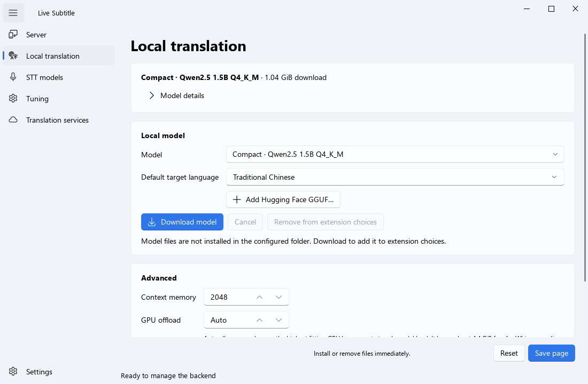
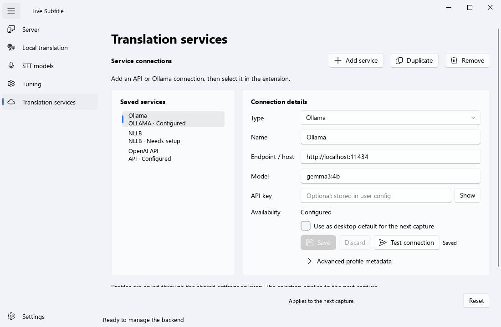
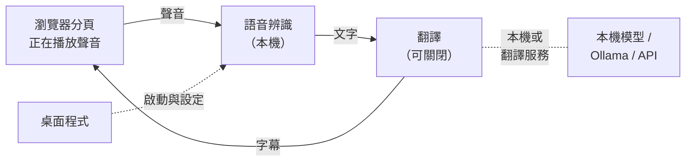

<div align="center">

<h1>Live Subtitle</h1>

<p><strong>瀏覽器分頁的即時字幕與翻譯，語音辨識在本機執行。</strong></p>

<p>
  <a href="LICENSE"></a>
  <a href="https://github.com/xu-0306/live-subtitle/releases/latest"></a>
  
  
</p>

<p>
  <a href="#快速開始">快速開始</a> ·
  <a href="#功能">功能</a> ·
  <a href="#運作方式">運作方式</a> ·
  <a href="https://github.com/xu-0306/live-subtitle/releases">下載</a> ·
  <a href="README.md">English</a>
</p>

</div>

<p align="center">
  <picture>
    <source media="(prefers-reduced-motion: reduce)" srcset="docs/media/demo.png">
    
  </picture>
  <br>
  <sub>影片：Conor Neill〈<a href="https://www.youtube.com/watch?v=c8_BIamLESg">Improve Your Speaking</a>〉，CC BY 授權。</sub>
</p>

Live Subtitle 擷取 Chrome／Edge 分頁的音訊，在本機以 Whisper 轉成字幕並顯示在網頁上。翻譯為選用功能，可在本機執行，也可使用自行設定的翻譯服務。

> [!NOTE]
> 公開預覽版，僅支援 Windows。擴充功能需透過開發人員模式載入；Windows 程式尚未簽署，首次執行時 SmartScreen 可能出現警告。

## 快速開始

需求：64 位元 Windows，以及 Chrome、Edge 等 Chromium 瀏覽器。建議使用 NVIDIA 顯示卡，但非必要。

1. **下載**：到[最新版本](https://github.com/xu-0306/live-subtitle/releases/latest)下載 `Live-Subtitle-windows-x64.zip` 和 `Live-Subtitle-chrome-extension-v<版本>.zip` 兩個檔案。
2. **開啟桌面程式**：解壓縮 Windows 套件，執行 `live-subtitle.exe`。首次啟動時會讀取顯示卡記憶體，推薦語音模型與翻譯設定。
3. **啟動伺服器**：在 **Server** 頁按 **Start backend**，等待狀態顯示為執行中。
4. **加入擴充功能**：解壓縮擴充功能套件，打開 `chrome://extensions`，開啟右上角的 **開發人員模式**，按 **載入未封裝項目**，選擇剛解壓縮的資料夾。
5. **開始擷取**：在正在播放語音的分頁點工具列上的 Live Subtitle 圖示，選擇翻譯方式與目標語言，按 **Start capture**。字幕框可拖曳及調整大小。

語音模型在首次使用時下載，因此第一次擷取需要較長的啟動時間。

<details>
<summary>改從原始碼執行</summary>

需求：Windows、Python 3.10 以上、對應 CUDA 或 CPU 環境的 PyTorch（需另外安裝），以及 Chromium 瀏覽器。

```powershell
git clone https://github.com/xu-0306/live-subtitle.git
Set-Location live-subtitle
py -3 -m venv .venv
.\.venv\Scripts\Activate.ps1
python -m pip install --upgrade pip
python -m pip install -r backend\requirements.txt
python -m pip install -r gui\requirements.txt
```

安裝 PyTorch 後啟動桌面程式：

```powershell
.\Start-GUI.bat
```

`.\Start-GUI.bat --check` 只做環境檢查。最後在 `chrome://extensions` 把 `chrome-extension` 資料夾載入為未封裝擴充功能。

</details>

## 功能

- **任何分頁皆可使用**：影音網站、直播、網頁會議皆可，並可同時擷取多個分頁。
- **選用翻譯**：只顯示原文、使用本機 GGUF 模型，或連接 Ollama、OpenAI 相容 API 等翻譯服務。
- **模型推薦**：首次啟動時讀取顯示卡記憶體，推薦低延遲、日常或高品質組合；沒有支援的顯示卡時推薦較小的模型。
- **字幕可調整**：位置、大小、字體大小、透明度、歷史行數，以及是否顯示辨識中的文字。
- **按需載入模型**：開始擷取才載入模型，最後一個分頁停止後釋放本機翻譯模型。

### 桌面程式

<table>
  <tr>
    <td width="50%">
      <picture>
        <source media="(prefers-color-scheme: dark)" srcset="docs/media/gui-local-dark.png">
        
      </picture>
      <p align="center"><em>本機翻譯模型</em></p>
    </td>
    <td width="50%">
      <picture>
        <source media="(prefers-color-scheme: dark)" srcset="docs/media/gui-services-dark.png">
        
      </picture>
      <p align="center"><em>翻譯服務連線</em></p>
    </td>
  </tr>
</table>

| 頁面 | 用途 |
| --- | --- |
| **Server** | 啟動、停止、重新啟動本機伺服器，查看日誌。 |
| **Local translation** | 下載並管理在本機執行的翻譯模型。 |
| **Speech recognition** | 選擇 Whisper 語音辨識模型。 |
| **Tuning** | 調整字幕與串流行為。 |
| **Translation services** | 儲存並測試 Ollama、OpenAI 相容 API、vLLM 等服務的連線。 |
| **Settings** | 主題、設定與模型存放位置、模型推薦，以及程式版本與更新檢查。 |

## 運作方式



擴充功能將分頁音訊傳送至本機伺服器（`ws://127.0.0.1:8765/asr`）。伺服器以 [WhisperLiveKit](https://github.com/QuentinFuxa/WhisperLiveKit) 進行語音辨識，視設定翻譯後將字幕送回網頁。桌面程式負責保存設定、模型檔案與翻譯服務連線，並啟動及停止伺服器。

### 翻譯方式

| 選項 | 說明 |
| --- | --- |
| **None** | 只顯示辨識出的原文，不翻譯。 |
| **Local translation** | 下載 llama.cpp 執行環境與 GGUF 翻譯模型，在本機翻譯。 |
| **Translation services** | 使用已儲存的服務連線（本機、區網、自架或雲端的 Ollama、OpenAI 相容 API、vLLM 等），由該服務翻譯。 |

### 隱私

分頁音訊只會傳送到本機伺服器。選用翻譯服務時，傳送的是辨識後的文字而非音訊，服務可能位於本機、區網或雲端。使用本機翻譯時，辨識與翻譯都在同一台電腦完成。API 金鑰、帳密與本機模型路徑不會傳給網頁。

**更新檢查。** 桌面程式與擴充功能各自向 GitHub 的公開 API 查詢最新版本（`GET https://api.github.com/repos/xu-0306/live-subtitle/releases/latest`），以便在有新版時通知你。送出的只有這個版本查詢：不含音訊、文字、設定、金鑰或帳號，也不帶 cookie 或 referrer。和任何網路請求一樣，GitHub 看得到你的 IP 位址。不會自動下載或安裝任何東西。桌面程式在啟動時最多每天檢查一次，擴充功能約每天在背景檢查一次；檢查失敗（例如離線）時不會有任何提示。可在桌面程式的 **Settings → About**、擴充功能的 **Options → About & updates** 關閉。

## 目前狀態與限制

- 仍在持續開發中。辨識與翻譯品質取決於模型、語言、音訊與硬體。
- 沒有顯示卡時，本機辨識與翻譯會明顯變慢。
- 桌面程式只支援 64 位元 Windows。
- 擴充功能需透過開發人員模式手動載入，尚未上架 Chrome 線上應用程式商店。
- Windows 執行檔尚未做程式碼簽署。

<details>
<summary>模型、資料夾與設定</summary>

### 模型與程式資料

發佈套件不含模型。語音模型在首次使用時下載，也可從 GUI 預先下載；本機翻譯模型從 **Local translation** 頁下載。

首次啟動時，設定助手透過 `nvidia-smi` 讀取 NVIDIA 顯示卡的總記憶體與可用記憶體，合併計算 Whisper 與本機翻譯的需求，推薦低延遲、日常或高品質組合。低於 8 GB 或沒有支援的 NVIDIA 顯示卡時，建議較小的 Whisper 搭配 CPU 翻譯，並說明外部翻譯服務的選項。可從 **Settings → Recommend model setup** 重新偵測。

套用推薦只會儲存選擇，不會自動下載大型檔案；請在 **Speech recognition** 與 **Local translation** 確認大小後下載。推薦的本機翻譯模型需下載並通過雜湊檢查後才會成為預設。

Windows 預設資料結構：

```text
%APPDATA%\Live Subtitle
├─ config.yaml
├─ Speech models\
└─ Local Translation Models\
```

在 **Settings → Model storage** 設定共用的模型資料夾，Whisper 權重與本機翻譯檔案會分別存放在其下。

舊版 `%APPDATA%\STT-TTS\config.yaml` 可複製到新資料夾；舊資料夾不會被刪除，已明確指定的模型路徑仍可使用。

### 不使用桌面程式

直接啟動後端時，可在擴充功能的 **Options** 頁完成常用設定：管理翻譯服務連線，以及儲存共用的語音、翻譯與目標語言預設值。模型的下載、發布與移除在桌面程式進行。Options 僅管理本機後端；金鑰可交由後端保存，但後端不會回傳金鑰。桌面程式沒有未儲存的修改時，會自動載入這些變更。

### 更新

兩邊都只會通知你有新版，不會自動下載或取代任何檔案，因為未封裝的擴充功能無法自行更新。桌面程式會顯示附發行說明的提示與開啟下載頁的按鈕，擴充功能則在彈出視窗與 Options 頁顯示同樣的通知。更新時，到[最新版本](https://github.com/xu-0306/live-subtitle/releases/latest)下載兩個 ZIP：解壓縮並執行新的 Windows 套件（`%APPDATA%\Live Subtitle` 內的設定與模型會保留），再把載入擴充功能的資料夾內檔案換成新版，並在 `chrome://extensions` 按下 **重新載入**。

版本號只記在一個地方：`chrome-extension/manifest.json`。發行標籤是 `v` 加上這個號碼，桌面程式讀的也是同一個檔案。

### 擴充功能權限

| 權限 | 用途 |
| --- | --- |
| `tabCapture`、`activeTab` | 擷取你開始產生字幕的分頁音訊。 |
| `offscreen` | 在 offscreen 文件中處理擷取到的音訊。 |
| `scripting` | 在網頁上顯示字幕框。 |
| `storage` | 保存你的設定。 |
| `alarms` | 約每天喚醒一次背景 service worker，進行更新檢查；不會增加安裝時的警告。 |
| 主機存取（`<all_urls>`） | 在任何網頁顯示字幕，並連到本機伺服器與你選的翻譯服務。更新檢查沿用這項權限，沒有新增任何主機權限。 |

### 設定的優先順序

1. 擴充功能中本次擷取的選擇
2. 桌面程式儲存的預設值
3. `backend/config.yaml` 的預設值

擴充功能可選擇語音與翻譯選項，但無法變更桌面程式的模型存放位置。

### 專案結構

- `backend/` — 本機伺服器：串流語音辨識、翻譯、模型管理和設定
- `gui/` — 桌面程式（PySide6）
- `chrome-extension/` — 分頁擷取、設定、背景 service worker、offscreen 音訊和字幕疊加層
- `docs/` — 架構、模型、啟動和介面行為文件
- `scripts/` — 從原始碼執行的輔助工具

</details>

## 相關文件

- [翻譯服務與模型選擇](docs/TRANSLATION_SERVICES.md)
- [受管理的本機翻譯](docs/LOCAL_TRANSLATION_MVP.md)
- [架構圖](docs/STT_TRANSLATION_ARCHITECTURE.md)
- [桌面程式啟動與打包](docs/GUI_STARTUP.md)

## 問題回報

請[建立 Issue](https://github.com/xu-0306/live-subtitle/issues)，並附上 Windows 版本、語音模型、翻譯方式、CPU／GPU，以及錯誤訊息或紀錄。

## 致謝與授權

- [WhisperLiveKit](https://github.com/QuentinFuxa/WhisperLiveKit) — 串流語音辨識引擎。
- [PySide6-Fluent-Widgets](https://pypi.org/project/PySide6-Fluent-Widgets/) — 桌面程式介面元件（GPLv3），已包含在 Windows 套件中。
- [FFmpeg](https://ffmpeg.org/) — 解碼擷取到的音訊。Windows 套件內附未修改的 GPLv3 建置（[gyan.dev](https://www.gyan.dev/ffmpeg/builds/)），說明見 `_internal\ffmpeg\ffmpeg-NOTICE.txt`。

Live Subtitle 以 [GNU General Public License v3.0](LICENSE) 釋出，其他隨附的第三方元件仍適用各自的授權。
